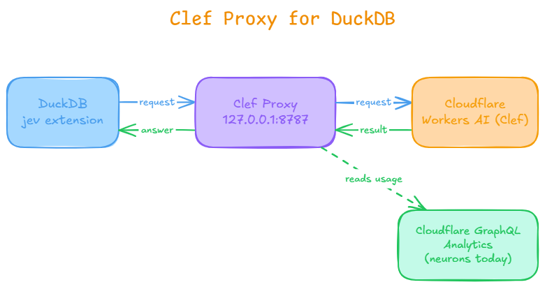
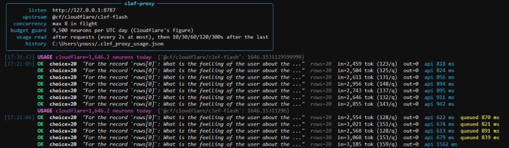

# Clef Proxy for DuckDB

Use plain-English conditions in DuckDB SQL, powered by Cloudflare's open **Clef** model, on the free tier.

```sql
SELECT * from apps_reviews where jev(apps_reviews, 'user has problem');
```

## What it is

The DuckDB `jev` extension talks to **Jev**, a paid model from TypeSafe AI. Cloudflare's **Clef** accepts almost the same requests, but lives at a different address, needs a Cloudflare token, and wraps its answers. `clef_proxy.py` is a small local server that bridges the two, so the extension works with Clef unchanged.



`DuckDB (jev)  →  proxy (127.0.0.1:8787)  →  Cloudflare Workers AI (Clef)`

For each request the proxy:

1. **Re-addresses** it to Workers AI and **adds your token** (DuckDB never sees it).
2. **Sets the model** to Clef and fills in any missing `instructions`.
3. **Unwraps** Cloudflare's `result` wrapper in the answer.
4. **Protects your quota**: limits parallel requests and stops at a daily budget.

## Jev vs Clef

Both are *decision models*: you give them text and questions, they return typed answers with probabilities (`noul` = yes/no, `choice` = pick one, `score` = position on a scale).

| | Jev | Clef |
|---|---|---|
| Made by | TypeSafe AI | Cloudflare |
| Weights | Closed | Open |
| Cost | Paid per token | Free daily allowance (10,000 neurons) on Workers AI |
| Request format | Jev API | Same as Jev |

Same SQL works with both, but **answers can differ**. Compare on your own data. ([Jev docs](https://docs.typesafe.ai/introduction), [Clef blog](https://blog.cloudflare.com/clef-decision-models/))

## The `jev` extension

| Function | Returns | Use it for |
|---|---|---|
| `jev(table, 'condition')` | `BOOLEAN` | Filtering in `WHERE` |
| `jev_prob(table, 'condition')` | 0 to 1 | Ranking with `ORDER BY` |
| `jev_choice(table, 'question', ['a','b'])` | One label | Classifying, `GROUP BY` |
| `jev_score(table, 'question', ['low','mid','high'])` | Position on a scale | Ordering by a rubric |

Needs DuckDB **v1.5.5 or v1.5.6**. It sends your **row contents** to the API, so don't use it on data you can't share. **Answers are cached by row content**, so repeated queries are free. ([DuckDB blog](https://duckdb.org/2026/09/29/jev))

## Quick start

**Requirements:** Python 3.10+, a free [Cloudflare](https://dash.cloudflare.com) account, DuckDB v1.5.5 or v1.5.6.

**1. Install**

```bash
uv add fastapi uvicorn httpx python-dotenv rich
# or if you clone the project
uv sync
```

**2. Get your Cloudflare credentials**

1. Dashboard → **Workers AI** → **Use REST API**.
2. **Create a Workers AI API Token** and copy it. Copy your **Account ID** too.
3. Edit that token (My Profile → API Tokens) and add permission **Account → Account Analytics → Read**. This lets the proxy read your *real* usage from Cloudflare. A separate token also works (see `CLOUDFLARE_ANALYTICS_TOKEN` below).

**3. Create a `.env` file**:

```
CLOUDFLARE_ACCOUNT_ID=your-account-id
CLOUDFLARE_API_TOKEN=your-token
```

**4. Start the proxy and check it**

```bash
python clef_proxy.py
curl http://127.0.0.1:8787/health # or from your browser
```

**5. Connect DuckDB**

```sql
INSTALL jev FROM community;
LOAD jev;

SET jev_api_url = 'http://127.0.0.1:8787/v1/systemone';
SET jev_api_key = 'local';                 -- placeholder; the real token stays in the proxy
SET jev_max_rows_per_statement = 100;      -- spending cap while testing
```

**6. Try it**

_You can also tested using the google play apps reviews in `google_play_reviews.sql`_
```sql
CREATE TABLE tickets AS SELECT * FROM (VALUES
  (1, 'card declined again, I want my money back'),
  (2, 'how do I export a dashboard to PDF?'),
  (3, 'I was charged twice for the same order')) t(id, body);

SELECT id, body, jev_prob(tickets, 'the customer wants a refund') AS p
FROM tickets ORDER BY p DESC;
```

The proxy terminal output (`google_play_reviews.sql` example):



## How the daily budget works

The proxy refuses requests (403) once today's usage reaches `DAILY_NEURON_LIMIT`, so you stay under the free 10,000.

- **The number:** today's neurons from Cloudflare's GraphQL Analytics API, the same figure the dashboard shows. It covers the **whole account**, not just this proxy. It is read at startup and after every request.
- **Why several reads:** Analytics updates a few minutes late, so the proxy reads again at 10, 30, 60, 120 and 300 seconds after the last request. A new request restarts that schedule.
- **If Cloudflare can't be read** (for example, the token lacks permission): the proxy keeps the last reading and logs a `USAGE` warning. If no read has ever worked, the guard stays off.

## Settings (optional, in `.env`)

| Variable | Default | Meaning |
|---|---|---|
| `CLEF_MODEL` | `clef-flash` | `clef-flash` (faster, cheaper) or `clef` (larger) |
| `HOST` | `127.0.0.1` | Address the proxy listens on (keep it local) |
| `PORT` | `8787` | Port the proxy listens on |
| `MAX_CONCURRENCY` | `8` | Max requests in flight to Cloudflare |
| `DAILY_NEURON_LIMIT` | `9500` | Proxy refuses calls at this daily usage |
| `USAGE_MIN_GAP` | `2` | Minimum seconds between Cloudflare usage reads |
| `USAGE_FOLLOW_UP` | `10,30,60,120,300` | Seconds after the last request to read usage again (empty = never) |
| `CLOUDFLARE_ANALYTICS_TOKEN` | API token | Separate token with *Account Analytics: Read* |
| `UPSTREAM_TIMEOUT` | `60` | Seconds to wait for Cloudflare |
| `STATE_TOKEN_WARN` | `2000` | Warn when a request's data is larger than this many tokens (estimate) |
| `CLEF_USAGE_FILE` | `~/.clef_proxy_usage.json` | Where the daily usage history is saved |